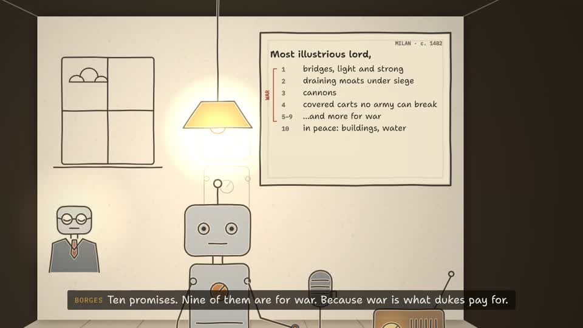

# The Letter — a one-minute art battle

**Same minute. Same words. Same voices. Only the pictures change.**

*The Letter* is a one-minute scene from [Future Radio](https://x.com/leo_guinan). In Milan around 1482, a young Leonardo da Vinci writes to the Duke of Milan offering ten services. Nine are for war, and painting comes near the end. The scene closes on a question: **who pays the painter now?**

The Future Radio studio made its cut first and locked it. Now anyone can make their own.

**December 2026 is battle month.** Anyone can enter with a one-minute rendition of this clip, in any style and any medium: hand-drawn, stop-motion, 3D, puppets, live action, code or AI. All entries go up side by side with the studio's cut, and viewers vote. Voting is free.

## How it started

On Day 3 of a public seven-day experiment on X, Leo Guinan asked strangers to pay a human animator to compete with the studio. [Garcia (@garcia590)](https://x.com/garcia590) paid $50, which funded the first minute. Garcia has backed these experiments for weeks with homework, feedback and the model behind compute grants for stories.

The first commissioned challenger is [Belen (@Belenndaniel)](https://x.com/Belenndaniel), a human animator, at $50 a minute. She accepted the commission on 2026-11-17. Her cut is in progress (2–3 weeks) and isn't in this repo yet.

## The kit

| File | What it is |
|---|---|
| [`kit/the-letter-sample-60s-audio.wav`](kit/the-letter-sample-60s-audio.wav) | **The soundtrack. Use it as is.** 60.00 s, 48 kHz stereo. |
| [`kit/the-letter-sample-60s.mp4`](kit/the-letter-sample-60s.mp4) | The studio's cut: what you're up against. 60.00 s, 1280×720, 30 fps. |
| [`kit/cue-sheet.md`](kit/cue-sheet.md) | Every line with its in and out time, who says it, the setting and the characters. |
| [`kit/SCRIPT.txt`](kit/SCRIPT.txt) | The script. |

sha256: MP4 `36bf6bab2a2fefefabda818d2b4ab27a607e2025f280ebda1a62fd08e3cd293b` · WAV `9d30e525f74efcec2eb7ec747d7b761b6273d91d4fddc47f259e6a7031880128`

## Enter

1. Download the WAV and the cue sheet.
2. Make 60 seconds of pictures to the soundtrack.
3. Post your cut publicly (X, YouTube, Vimeo, or a direct video link).
4. Open an issue using the **Battle entry** form, or open a pull request that adds `entries/<your-handle>/ENTRY.md` (copy [`entries/_template/ENTRY.md`](entries/_template/ENTRY.md)).

Read the [rules](RULES.md) before you start. They're short.

## The entries

| Entry | By | Medium | Link |
|---|---|---|---|
| The studio's cut (locked 2026-11-17) | Future Radio studio | 2D vector, rendered in code | [`entries/studio/ENTRY.md`](entries/studio/ENTRY.md) |
| *(commissioned 2026-11-17, in progress)* | Belen (@Belenndaniel) | — | — |

## The cast

- **Leonardo** writes the letter.
- **Borges** narrates.
- **Agnolo** keeps the books and heckles.

In the studio's cut they're a robot at a desk, a portrait on the wall and a voice from a radio. In yours they can be anything.

*Voices are AI-generated (ElevenLabs). The script paraphrases Leonardo's letter to Ludovico Sforza, c. 1482; it isn't a translation.*
